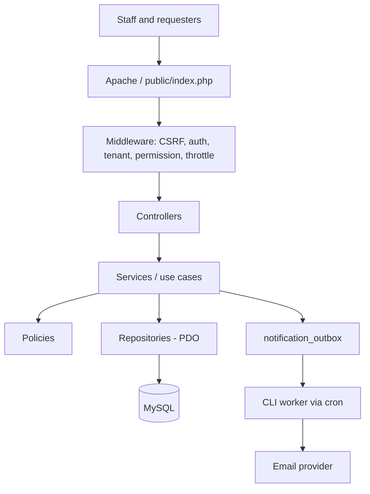
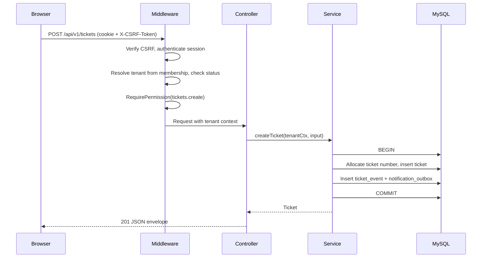
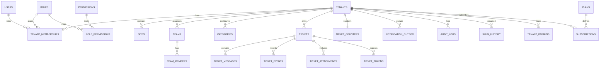
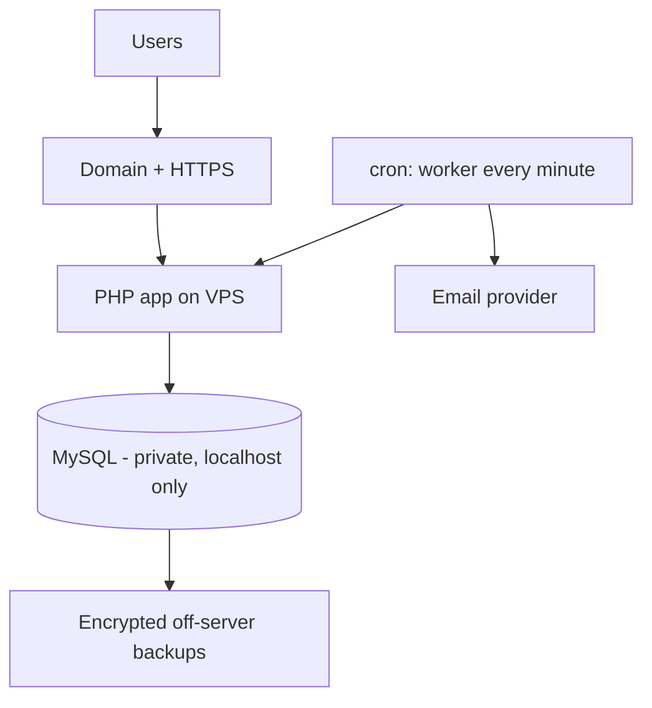

# HudumaDesk — Design.md

**Version 1.1 · Technical and UX design (implementation plan, as I would build it)**
Companion to `Project.md` (scope, roles, roadmap) and `API.md` (routes and JSON).

---

## 1. Architecture

Modular monolith: one deployable PHP app, clear responsibilities, no extra infrastructure.



### Layer rules

| Layer | Responsibility | Must not |
|---|---|---|
| Route file | URL, name, middleware, required permission (`->can()`) | Contain logic |
| Controller | Receive a validated request and `TenantContext`, call one service, return a Twig page, redirect or JSON | Hold business rules or SQL |
| Request class | Validate and normalize input; one class per form or endpoint | Decide permissions |
| Service | One use case (`CreateTicket`), owns the transaction, writes events and outbox rows | Render output |
| Policy | Can *this user* do *this action* on *this resource in this tenant* | Run broad queries |
| Repository | SQL through the query builder; extends `TenantScopedRepository` | Decide permissions |
| View (Twig) | Escaped HTML | Query the database or call services |
| Domain | `TicketLifecycle`, `DueDateCalculator`, `TicketReference`, value objects | Touch HTTP or the database |
| Core | Router, container, request/response, query builder, session, validator, Twig factory | Contain ticket logic |

> Don't create a class for every trivial operation. Add an abstraction only when it has a clear job.

### Conventions borrowed from Laravel (no Laravel dependency)

The core stays small, but the code reads the way Laravel developers expect.

**1. Route files with names, groups, middleware and permissions**
```php
// routes/web.php
$router->group(['prefix' => '/app', 'middleware' => ['auth', 'tenant']], function ($r) {
    $r->get('/tickets',        [TicketController::class, 'index'])->name('tickets.index')->can('tickets.view_team');
    $r->post('/tickets',       [TicketController::class, 'store'])->name('tickets.store')->can('tickets.create');
    $r->get('/tickets/{ref}',  [TicketController::class, 'show'])->name('tickets.show');
});
```

**2. Request classes (like `FormRequest`)**
```php
final class StoreTicketRequest extends FormRequest
{
    public function rules(): array
    {
        return [
            'subject'     => 'required|string|max:200',
            'description' => 'required|string|max:5000',
            'category_id' => 'nullable|int',
            'priority'    => 'in:low,normal,high,urgent',
        ];
    }
}
```
Controllers only ever see validated data. On failure, Twig pages redirect back with errors and old input; JSON returns the `422` envelope.

**3. Thin controllers with constructor injection**
```php
final class TicketController
{
    public function __construct(private CreateTicket $createTicket) {}

    public function store(StoreTicketRequest $req, TenantContext $ctx): Response
    {
        $ticket = $this->createTicket->handle($ctx, $req->validated());
        return redirect(route('tickets.show', ['ref' => $ticket->reference]))
            ->with('success', 'Ticket created.');
    }
}
```

**4. A tiny auto-wiring container** (about 60 lines, uses Reflection on constructor type hints)
```php
final class Container
{
    private array $factories = [];
    private array $instances = [];

    public function bind(string $id, callable $factory): void { $this->factories[$id] = $factory; }

    public function get(string $id): object
    {
        return $this->instances[$id] ??= isset($this->factories[$id])
            ? ($this->factories[$id])($this)
            : $this->autowire($id);   // resolves constructor dependencies recursively
    }
}
```

**5. Helpers** (`app/Core/helpers.php`): `config()`, `env()` (only inside `config/*.php`), `route()`, `redirect()`, `view()`, `old()`, `e()`, `now()`, `abort()`, `can()`, `csrf_field()`. In Twig these are registered as functions.

**6. Flash messages and old input** on top of the session: `->with('success', …)`, `->withErrors($errors)->withInput()`.

**7. Fluent query builder over PDO** (no ORM)
```php
$rows = $this->query($ctx)            // already has WHERE tenant_id = ?
    ->where('status_id', $statusId)
    ->orderBy('created_at', 'desc')
    ->paginate(25);
```
Everything is a prepared statement. No model magic, lazy loading or global scopes, because those hide where tenant filtering happens.

**8. One CLI entry point: `php hd`**
```
php hd migrate            php hd migrate:status
php hd seed               php hd admin:create
php hd queue:work [--once]
php hd tenant:suspend gleehotel      php hd tenant:reactivate gleehotel
```
Commands are classes in `app/Console/Commands/`, discovered by the kernel.

**9. Config layout:** `config/*.php` return arrays, read with `config('mail.host')`; `.env` is read only inside config files.

**What I deliberately do not copy:** facades and static magic (`Auth::user()`), service providers, Eloquent (relationships, observers, global scopes), the event/listener system, broadcasting and queue drivers (the outbox table covers it), and the Blade compiler (Twig replaces it).

### Tenant isolation in code
```php
final class TenantContext
{
    public function __construct(
        public readonly int $tenantId,
        public readonly int $userId,
        public readonly string $role,
        private array $permissions,
    ) {}

    public function can(string $permission): bool { return in_array($permission, $this->permissions, true); }
}

abstract class TenantScopedRepository
{
    protected string $table;
    public function __construct(protected Database $db) {}

    protected function query(TenantContext $ctx): QueryBuilder
    {
        return $this->db->table($this->table)->where('tenant_id', $ctx->tenantId);
    }
}
```
- Middleware builds `TenantContext` once from the authenticated membership. Nothing else can, and request fields are never trusted for it.
- Services and repositories require `TenantContext`, not a bare integer.
- A `TenantScopeLintTest` scans repository files and fails if a query on a tenant table bypasses `query($ctx)` without an explicit, commented exception.
- Composite foreign keys on ticket → team, site and category. `tenant_id` leads every index.

### Views: Twig
- Templates live in `resources/views/*.twig` with a `base.twig` layout and partials.
- Auto-escaping is on. `strict_variables` is on in development. Compiled cache goes to `storage/cache/twig`.
- A test greps templates for `|raw` and fails unless the line is explicitly allow-listed.
- Registered functions: `route()`, `can()`, `old()`, `csrf_field()`, `config()`, `flash()`, `asset()`.
- Templates receive data only. They never query the database or call services.

### Folder structure

```text
hudumadesk/
├── app/
│   ├── Console/
│   │   ├── Kernel.php
│   │   └── Commands/        # Migrate, MigrateStatus, Seed, CreateAdmin, QueueWork, TenantSuspend
│   ├── Core/                # Application, Container, Router, Route, Request, Response, Redirect,
│   │                        # Database, QueryBuilder, Session, Flash, Validator, FormRequest,
│   │                        # TwigFactory, helpers.php
│   ├── Http/
│   │   ├── Controllers/     # Auth, Workspace, Tickets, Team, Reports, Platform, PublicSite, Api
│   │   ├── Middleware/      # Authenticate, ResolveTenant, ResolvePublicTenant, RequirePermission,
│   │   │                    # VerifyCsrf, ThrottleRequests, RequireGuest
│   │   └── Requests/        # StoreTicketRequest, AssignTicketRequest, ...
│   ├── Domain/              # TicketLifecycle, DueDateCalculator, TicketReference, value objects
│   ├── Services/            # Auth, Tenants, Tickets, Teams, Notifications, Reports (use cases)
│   ├── Repositories/        # TenantScopedRepository + one class per aggregate
│   ├── Policies/
│   ├── Mail/                # Mailer wrapper, templates
│   └── Support/             # Tokens, Slug, Clock, Uploads, PublicUrl, TenantResolver
├── config/                  # app, database, mail, security
├── database/
│   ├── migrations/
│   └── seeds/
├── hd                       # CLI entry point (php hd ...)
├── resources/
│   ├── views/               # Twig templates
│   ├── css/
│   ├── js/
│   ├── lang/                # en.php, sw.php (Kiswahili later)
│   └── images/
├── routes/                  # web.php, api.php, public.php, platform.php
├── storage/                 # logs, cache, private (uploads)
├── tests/                   # Unit, Feature, Integration, Security
├── public/                  # index.php, .htaccess, assets/  ← only web-visible directory
├── .env.example
├── composer.json
├── phpunit.xml
└── README.md
```

### Dependencies
`twig/twig` · `symfony/mailer` · `vlucas/phpdotenv` · `monolog/monolog` · dev: `phpunit/phpunit`, `phpstan/phpstan`. Pin versions in `composer.lock`. Everything else is native PHP (PDO, `password_hash`, sessions). The router, container, validator, query builder, flash and CLI are written in-house (about 1,000 lines) and fully covered by unit tests.

### Database engine
XAMPP ships MariaDB. Choose one engine and version (MySQL 8 or MariaDB 10.6+) and use it locally, in CI and in production. JSON column behavior, `SKIP LOCKED` and some index behavior differ between them. CI (e.g. GitHub Actions with a DB service) runs migrations from an empty database and the full integration and security suites on that exact engine.

---

## 2. Request lifecycle



Tenant context object `{tenant_id, user_id, role, permissions}` is built **once** by middleware and passed to services. Request bodies never supply it.

---

## 3. Database design

InnoDB, `utf8mb4`, UTC `DATETIME`, unsigned `BIGINT` PKs, explicit foreign keys. No `ENUM`; use lookup tables or validated codes.

### ER diagram



### Migration order (immutable once applied)

| # | File | Contents |
|---|---|---|
| 0001 | `create_users` | Accounts, `is_platform_admin` |
| 0002 | `create_tenants` | Workspaces, status, slug, slug history, private key, form mode |
| 0003 | `create_memberships` | Memberships, invitations |
| 0004 | `create_roles_permissions` | Roles, permissions, mapping |
| 0005 | `create_sites_teams` | Sites, teams, team members |
| 0006 | `create_ticket_reference_data` | Statuses, priorities, categories |
| 0007 | `create_tickets` | Tickets, counters, indexes |
| 0008 | `create_ticket_messages` | Replies and internal notes |
| 0009 | `create_ticket_events` | Change history |
| 0010 | `create_attachments_tokens` | Attachments, tracking tokens |
| 0011 | `create_notifications` | Outbox and attempts |
| 0012 | `create_audit_logs` | Security audit events |
| 0013 | `create_plans_subscriptions` | Manual plans and subscriptions |
| 0014 | `create_password_resets` | Single-use reset tokens |
| 0015 | `add_ticket_sla_fields` | `due_at` indexes, reporting indexes |
| 0016 | `create_tenant_domains` | Custom domains (post-pilot, can wait) |

Ledger table `schema_migrations(filename, checksum, applied_at)`. Never edit an applied file; add a new one. The runner refuses to run if a checksum changed.

### Key tables

**users**: `id, first_name, last_name, email (normalized, UNIQUE), password_hash, status, is_platform_admin, email_verified_at, last_login_at, created_at, updated_at`

**tenants**: `id, name, slug (UNIQUE), public_key (UNIQUE, random), public_form_mode ('slug'|'private'), public_form_enabled, status, timezone, contact_email, contact_phone, settings_json, created_at, updated_at`
`settings_json` holds small settings such as `allowed_email_domains` and `allow_requester_replies`.

**slug_history**: `id, tenant_id, old_slug (UNIQUE), changed_at` for redirecting old public links.

**tenant_domains** (post-pilot): `id, tenant_id, domain (UNIQUE), status ('pending_verification','active','failed'), verification_token, verified_at, ssl_status, created_at`

**tenant_memberships**: `tenant_id, user_id, role_id, status, joined_at, created_at` · PK `(tenant_id, user_id)`

**invitations**: `id, tenant_id, email, role_id, token_hash, invited_by, expires_at, accepted_at, revoked_at`

**sites** `id, tenant_id, name, address, status` · **teams** `id, tenant_id, name, site_id NULL, status` · **team_members** `tenant_id, team_id, user_id`
Add `UNIQUE (tenant_id, id)` on sites, teams, categories so tickets can reference them with composite keys.

**categories**: `id, tenant_id, name, default_priority_id, team_id NULL, status`

**ticket_statuses / ticket_priorities** (global): `id, code, label, sort_order, is_terminal`, plus `default_hours` on priorities.

**ticket_counters**: `tenant_id PK, last_number`

**tickets**
```
id, tenant_id, ticket_number, site_id NULL, category_id NULL,
requester_user_id NULL, requester_name, requester_email,
team_id NULL, assigned_user_id NULL, subject, description,
status_id, priority_id, source ('public','staff'), version INT UNSIGNED NOT NULL DEFAULT 1,
due_at NULL, resolved_at NULL, closed_at NULL, created_at, updated_at
UNIQUE (tenant_id, ticket_number)
FK (tenant_id, team_id)     → teams (tenant_id, id)
FK (tenant_id, site_id)     → sites (tenant_id, id)
FK (tenant_id, category_id) → categories (tenant_id, id)
```
Display reference: `HD-` + zero-padded `ticket_number` (e.g. `HD-000123`). Staff URLs use the reference (`/app/tickets/HD-000123`); the app parses the number and loads `WHERE tenant_id = ? AND ticket_number = ?`. Global database IDs never appear in URLs. Status, assignment, priority and edit updates run `UPDATE … WHERE … AND version = ?` and bump `version`; zero rows affected means `409 version_conflict`.

Assignee check (`assigned_user_id` must be an active member of the tenant) is enforced in the service and covered by a test.

**ticket_messages**: `id, tenant_id, ticket_id, author_user_id NULL, author_name, visibility ('public'|'internal'), body, source ('staff','requester','system'), created_at`

**ticket_events**: `id, tenant_id, ticket_id, actor_user_id NULL, event_type, old_value JSON, new_value JSON, created_at` (status, assignment, priority, due date, reopen). No secrets or message bodies.

**ticket_attachments**: `id, tenant_id, ticket_id, message_id NULL, storage_key (random), original_name, mime_type, size_bytes, uploaded_by NULL, created_at`

**ticket_tokens**: `id, tenant_id, ticket_id, token_hash (UNIQUE), expires_at NULL, revoked_at NULL, created_at`

**notification_outbox**: `id, tenant_id, event_type, recipient_email, payload JSON, status ('pending','sent','failed'), attempts, last_error, available_at, sent_at, created_at`

**audit_logs**: `id, tenant_id NULL, actor_user_id NULL, action, resource_type, resource_id, ip, metadata JSON, created_at`

**plans**: `id, code, name, monthly_price_minor, max_agents, max_tickets_per_month` · **subscriptions**: `id, tenant_id, plan_id, status, current_period_start, current_period_end`

**password_resets**: `id, user_id, token_hash, expires_at, used_at`

### Indexes (start here, verify with `EXPLAIN`)
- `tickets (tenant_id, status_id, created_at)`
- `tickets (tenant_id, assigned_user_id, status_id)`
- `tickets (tenant_id, team_id, status_id)`
- `tickets (tenant_id, due_at)` for overdue lists
- `tickets (tenant_id, requester_email)`
- `ticket_messages (tenant_id, ticket_id, created_at)`
- `notification_outbox (status, available_at)`

### Ticket numbering
Inside the creation transaction:
```sql
INSERT INTO ticket_counters (tenant_id, last_number) VALUES (:t, 1)
  ON DUPLICATE KEY UPDATE last_number = LAST_INSERT_ID(last_number + 1);
SELECT LAST_INSERT_ID();
```
Use the returned number for the ticket. The unique key `(tenant_id, ticket_number)` is the safety net. Concurrency test required.

### Tenant-scoped query rule
```sql
SELECT * FROM tickets WHERE id = :id AND tenant_id = :tenant_id LIMIT 1;
```
Every repository method that touches tenant data takes `$tenantId` as a required argument. A method without it does not compile in review.

### Seeds
- `php hd seed`: development demo data and reference rows only. No public default passwords.
- Reference data (statuses, priorities, permissions, roles) is inserted by a migration-safe seeder that runs in production too.
- `php hd admin:create`: interactive prompt for the platform admin credentials.

---

## 4. Security design

Biggest risk: **cross-tenant data leakage**, then account takeover, attachment access and email abuse.

| Risk | Control |
|---|---|
| Cross-tenant access (IDOR) | Tenant from membership only; id + tenant_id queries; 404 on miss; composite FKs; Security tests |
| SQL injection | PDO prepared statements, `ATTR_EMULATE_PREPARES=false`, no concatenated SQL |
| XSS | Twig auto-escaping on, `|raw` banned by a test, no raw HTML from users, strict CSP |
| CSRF | Per-session token on every mutation; header for JSON |
| Session theft | `Secure`, `HttpOnly`, `SameSite=Lax`, regenerate on login/role change, idle + absolute timeout |
| Revoked access | Session checks membership + tenant status on each request (cheap indexed lookup) |
| Password handling | `password_hash(PASSWORD_DEFAULT)`; minimum 10 chars; no composition rules theatre |
| Reset tokens | Random 32 bytes, hashed in DB, 1 hour expiry, single use, no email enumeration |
| Public tracking | 32-byte random token, hash stored, revocable, shows public data only |
| Public form abuse | Honeypot, per-IP and per-tenant rate limits, optional allowed email domains, tenant `public_form_enabled` switch. A guessable slug is acceptable because the form exposes no private data |
| Uploads | Allowlist, size cap, server-side MIME check, random storage key, stored in `storage/private`, authorized download |
| Email abuse | Rate limits, honeypot, verified sender domain (SPF/DKIM), retry caps |
| Secrets | `.env` outside web root, never in Git or logs |
| Privilege escalation | Role changes checked in policy; last owner protected; admins cannot make owners |
| Platform admins | Metadata only; any support access is explicit, time-limited, audited |
| Backups | Encrypted, off-server, restore tested |

### Security headers (production)
`Strict-Transport-Security`, `X-Content-Type-Options: nosniff`, `X-Frame-Options: DENY`, `Referrer-Policy: same-origin`, `Content-Security-Policy: default-src 'self'` (adjust only for needed assets).

### Rate limiting
Simple DB or file-based counter keyed by route + IP (+ email/token). Values are in `API.md` §8. No Redis needed at MVP.

---

## 4a. Public form URLs and custom domains

### Which URL form to use
- **Default:** readable slug, `/request/gleehotel`. Easy to type, print on a QR code and trust.
- **Private mode (optional):** the workspace swaps to the random `public_key`. The slug URL then returns a neutral `404`. "Regenerate link" rotates the key and kills the old link.
- Neither is treated as security. The real protections are rate limits, the honeypot, allowed email domains and the enable switch.
- **Tracking links** are always long random tokens, never slugs.

### Slug rules
Lowercase `a-z`, `0-9`, `-`; 3–40 characters; unique; not in the reserved list (`app, api, admin, platform, login, register, track, request, invite, www, support, help, static, assets`). Only the owner can change it. The old slug is stored in `slug_history` and redirects with `301` for at least 12 months, so printed QR codes keep working.

### Resolving the public tenant (single entry point)
```php
// app/Support/TenantResolver.php
resolvePublicTenant(string $host, ?string $identifier): ?Tenant
```
1. If `$host` is a verified custom domain in `tenant_domains` (`status = 'active'`) → that tenant.
2. Else if `$identifier` matches a tenant `slug` and `public_form_mode = 'slug'` → that tenant.
3. Else if `$identifier` matches `public_key` and `public_form_mode = 'private'` → that tenant.
4. Else if `$identifier` matches `slug_history` → redirect to the current slug.
5. Else → `404`.
Suspended or disabled-form tenants return a neutral "unavailable" page. Controllers never look up tenants themselves.

### Building links
All links in pages and emails come from one helper, `PublicUrl::requestForm($tenant)` and `PublicUrl::track($tenant, $token)`. It returns the custom domain when active, otherwise `APP_URL` + slug or key. Nothing hardcodes a domain.

### Custom domains (post-pilot)
Example: `helpdesk.gleenairobi.com`.
1. Owner enters the domain; the app returns a CNAME (`custom.hudumadesk.co.ke`) and a TXT verification value.
2. The owner adds both records at their DNS provider.
3. `verify` checks DNS. Ownership must be proven before activation, otherwise anyone could point a domain at the app.
4. A certificate is issued. On a single VPS, use Caddy with on-demand TLS (restricted to domains marked `active`) or Certbot per domain.
5. On each request the app reads `Host` and resolves the tenant as above.

Scope: **public pages only** (request form and tracking). Staff sign-in remains on the main app domain, which avoids cross-domain cookie and CSRF complexity. SPF/DKIM for sending mail from the customer's own domain is a separate, optional setup. Offer it on a higher plan, since it carries support cost.

---

## 5. Notifications (transactional outbox)

1. Service writes the event **and** an outbox row in the same transaction.
2. `php hd queue:work` (cron, every minute, or a supervised loop) selects `pending` rows with `available_at <= now`, locks them (`SELECT … FOR UPDATE SKIP LOCKED` on MySQL 8, or an `UPDATE … WHERE status='pending' LIMIT n` claim), sends, then marks `sent` or schedules a retry.
3. Retries: 1 min, 5 min, 30 min, 2 h, 12 h, then `failed` and logged.
4. Templates in `app/Mail/`; plain-text + simple HTML; each includes the tracking link for requesters.
5. A `NotificationChannel` interface (`send(Notification): Result`) lets WhatsApp/SMS plug in later. Email is the only implementation.

| Event | Recipient |
|---|---|
| Ticket created | Requester (confirmation), team/admins (new ticket) |
| Assigned | Assigned agent |
| Public reply | Requester, or assignee if the requester replied |
| Status changed / resolved | Requester |
| Overdue (later) | Assignee and admins |

Tests use a fake mailer. Real sending needs explicit config.

---

## 6. Lifecycle and business rules

- **`TicketLifecycle`** holds the only transition table (see `Project.md` §5). Controllers never compare status strings.
- Creating a ticket: validate → resolve category → default team/priority → compute `due_at` → allocate number → insert ticket → event `created` → outbox rows → commit.
- Assigning: verify team and user are in the same tenant → update → event `assigned` → outbox.
- Resolve/close: set timestamps; reopen clears them and logs `reopened`.
- Requester reply on a `pending` ticket returns it to `in_progress`; on a `closed` ticket, only if the workspace allows reopen.
- **Overdue is computed**, never stored: `due_at < UTC_TIMESTAMP()` and status is not terminal. No cron job, no stale flag.
- **Optimistic locking:** ticket mutations carry the loaded `version`; a mismatch returns `409 version_conflict`.
- Suspended tenants: private routes return `403 tenant_suspended`; the public form shows a neutral "unavailable" page.
- Plan limits (agents, tickets/month) are checked at invitation and ticket creation; exceeding returns `403 plan_limit_reached` with a friendly message. Platform admin can adjust manually.

---

## 7. UI / UX design

**Principles:** mobile-first, lightweight (target < 150 KB per page), works on a cheap Android phone and slow data, plain language, English first with Kiswahili strings prepared via a translation file.

### Stack
Twig templates, hand-written CSS (one small stylesheet, CSS variables) and vanilla JS modules calling `/api/v1` with `fetch`. Every page works without JavaScript through normal form posts; JS only improves it. No frontend framework and no required build step. System font stack.

### Key screens

| Screen | Contents |
|---|---|
| Register / Login | Single column; workspace name, timezone defaulting to `Africa/Nairobi` |
| Dashboard | Count cards (open, unassigned, overdue, resolved today), "needs attention" list, recent tickets |
| Ticket list | Filter bar (status, priority, team, assignee, search), card list on mobile, table on desktop, overdue badge |
| Ticket detail | Header (reference, status, priority, due), assign/status/priority controls, conversation with clear **Reply to customer** vs **Internal note** tabs (internal notes visually distinct), attachments, history timeline |
| New ticket | Short form: requester, subject, description, category, priority; team auto-fills from category |
| Teams / Members | Lists with inline add/invite, role selector, disable toggle |
| Settings | Name, timezone, contact details, public form link + QR code, slug editor with availability check, private-link toggle and regenerate, allowed email domains, custom domain (later), other toggles |
| Reports | Date range, resolution time, tickets by category/agent, CSV export |
| Public request form | Branded with workspace name, 5 fields, success page with reference and tracking link |
| Tracking page | Status badge, public messages, reply box |
| Platform console | Tenant list, status, usage, suspend/reactivate |

### Interaction details
- 15-minute onboarding: after registration, a three-step checklist (add a team, invite staff, share the request link/QR).
- Optimistic UI is avoided; show a spinner and the server result so errors are always real.
- Every action has a clear success/failure toast driven by the API `error.message` and `fields`.
- Accessible: labels on inputs, focus states, contrast ≥ 4.5:1, touch targets ≥ 44px.
- Status and priority use text + color, never color alone.
- Offline/error handling: a visible banner on network failure; drafts of replies kept in memory until sent.

### Starter template (hotel / SME)
Pre-created on registration, editable:
- Teams: IT, Engineering/Maintenance, Housekeeping, Front Office.
- Categories: Wi-Fi/Network, Computer/Printer, Room maintenance, Housekeeping, POS/Systems, Other.
- Priorities with default due hours.
The template is plain seed data applied by a `WorkspaceTemplate` service, not code branches.

Example: **Glee Hotel Limited** registers with slug `gleehotel`. Teams IT, Engineering, Housekeeping and Front Office are created; Wi-Fi, Computer/Printer and POS categories map to IT, Room maintenance to Engineering. The request form is `/request/gleehotel`, optionally limited to `gleehotel.co.ke` emails.

---

## 8. Testing strategy

| Suite | Covers |
|---|---|
| Unit | Lifecycle transitions, validators, permission decisions, due-date rules, numbering helper |
| Integration (MySQL) | Migrations from empty DB, FKs, unique keys, rollback, concurrent numbering, tenant-scoped queries, outbox atomicity |
| Feature | Register, invite/accept, create/assign/reply/resolve/reopen, retry email, reports |
| **Security** | The cross-tenant list in `Project.md` §9, CSRF, XSS, SQLi probes, privilege escalation, session invalidation, token guessing, attachment access |
| Browser/deploy | Mobile layout, expired sessions, HTTPS, error pages, backup restore |

Use a dedicated test database, fake mailer, and a helper that builds Tenant A / Tenant B fixtures. CI runs on every push against the same DB engine and version as production: PHP lint, PHPStan, unit, integration and security suites. Extra guard tests: `TenantScopeLintTest` (repositories cannot skip tenant scoping) and a Twig `|raw` scan.

---

## 9. Environments and deployment

### Local (Windows / XAMPP)
1. `git init`, install Composer and a PHP version matching production (XAMPP uses MariaDB, so match your production engine and version), enable `pdo_mysql`, `mbstring`, `openssl`, `fileinfo`.
2. Create `hudumadesk_dev` and `hudumadesk_test` databases with a dedicated user.
3. Copy `.env.example` → `.env`.
4. `php hd migrate` then `php hd seed`.
5. Point an Apache VirtualHost (e.g. `hudumadesk.local`) at `public/`. **Not** the project root.
6. Verify `.env`, `storage/` and `app/` return 403/404 over HTTP.
7. Run the worker by hand: `php hd queue:work --once`.

### `.env.example` (keys only)
```
APP_ENV=local
APP_DEBUG=true
APP_URL=http://hudumadesk.local
DB_HOST=127.0.0.1
DB_NAME=hudumadesk_dev
DB_USER=
DB_PASS=
MAIL_DRIVER=log
MAIL_HOST=
MAIL_PORT=587
MAIL_USER=
MAIL_PASS=
MAIL_FROM_ADDRESS=
SESSION_NAME=hd_session
UPLOAD_MAX_MB=5
```

### Production



- One VPS to start: Apache or Nginx + PHP-FPM, MySQL bound to `127.0.0.1`, firewall allowing only 80/443/SSH (key auth).
- HTTPS via Let's Encrypt; force redirect; HSTS.
- Deploy: pull tag → `composer install --no-dev` → `php hd migrate` → reload PHP-FPM. Keep the previous release for rollback.
- Backups: nightly `mysqldump` + `storage/private` archive, encrypted, copied off-server, **restore drill before the pilot**.
- Monitoring: uptime check, disk and outbox-backlog alerts, error log rotation.
- `display_errors=Off`; log errors to `storage/logs` without sensitive data.

---

## 10. Extension points (built later, designed now)

| Future feature | Hook |
|---|---|
| WhatsApp / SMS | `NotificationChannel` + inbound webhook that calls `CreateTicket` / `AddMessage` services |
| M-Pesa Daraja | `PaymentProvider` interface; verified callbacks; idempotent payment rows |
| Custom roles | `roles.tenant_id` nullable column already supported by the permission map |
| SLA calendars | Replace the due-hours rule behind a `DueDateCalculator` |
| API keys | Token auth middleware in front of `/api/v1` |
| Object storage | `FileStore` interface (local disk first) |
| Custom domains | `TenantResolver` host lookup + `tenant_domains` table + `PublicUrl` helper (see §4a) |

---

## 11. Definition of done (per slice)

- Feature works end to end (route → service → DB → response/page).
- Policy and tenant scoping applied; at least one negative test (wrong tenant, wrong role).
- Input validated; output escaped.
- Events/audit written where required.
- Documented in `API.md` if a route changed.

---

## 12. What I cut or deferred, and why

| Item | Decision | Reason |
|---|---|---|
| Workspace switching UI/endpoint | Post-pilot | One workspace per user is enough for the first customers; memberships already allow more |
| CSV export, full reports page | Post-pilot | Four dashboard numbers answer the pilot's questions |
| Custom domains, slug history UI | Hooks built, feature later | Real support work; do it when a customer asks |
| Redis, queue drivers | Never needed at MVP | MySQL outbox + cron worker and a small rate-limit table are enough |
| ORM / Eloquent-style models | Not used | Model magic hides where tenant filtering happens |
| Frontend framework | Not used | Twig + small JS is faster on cheap phones and simpler to secure |
| WhatsApp, SMS, M-Pesa | After the pilot | Behind `NotificationChannel` and `PaymentProvider` interfaces |

## 13. Risks I would watch

1. **Email deliverability.** Use a transactional provider, set SPF and DKIM on the sending domain from day one, and show failed sends in the outbox UI.
2. **Restores.** Practise a backup restore before the pilot goes live.
3. **Uploads.** Treat every file as hostile: allowlist, size limit, private storage, `nosniff`.
4. **Isolation regressions.** The Tenant A/B suite and `TenantScopeLintTest` run in CI on every push.
5. **Data Protection Act obligations.** Settle registration and privacy notices before real customer data is stored.
